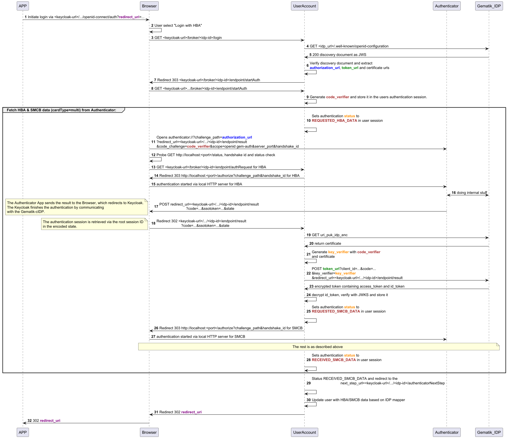

# New Authentication Flow

Supported only in Gematik Authenticator version above 4.6.0 via the `authenticator://` Authenticator Url's with
``Authentication Flow`` set to ``Authentication with a single Gematik-Authenticator request.``

## Flow Diagram

1. User initiated login
2. User selects the `Login with HBA`, which triggers the gematik-idp
3. First call to Keycloak, initiating the IDP flow
4. Keycloak fetches the openid-configuration from C-IDP: [example configuration](/docs/openid-config.json)
5. C-IDP responds with the openid-configuration as JWS
6. Keycloak verifies the JWS and extracts the following claims:
    - issuer
    - authorization_endpoint
    - token_endpoint
    - jwks_uri
    - uri_puk_idp_enc
    - uri_puk_idp_sig
    - exp (expiration time)
7. After fetching the config, Keycloak redirects the user to /startAuth
8. /startAuth is called from the browser
9. Keycloak generates `code_verifier` and stores it in the session of the user
10. Generate the deeplink to the Authenticator, passing among other things
    1. challenge_path: url to the C-IDP
       1. Containing a field name ``cardType`` set to multi
    2. redirect_url: url to Keycloak
    3. code_challenge: generated `code_verifier`
    4. server_port: free port on local HTTP server
    5. handshake_id: id to verify the communication partners
11. Authenticator app opens and starts a HTTP server on the local port in the background
12. Browser checks if HTTP server is available
13. Browser starts authentication
14. Redirect to /authorize endpoint on HTTP server for HBA
15. Authenticator app automatically starts HBA flow
16. Authenticator app and C-IDP communicate, exchanging certificates and HBA/SMCB data
17. Authenticator calls `redirect_url`
18. Keycloak responds with 200 and saves the HBA/SMCB data
19. Keycloak fetches certificate from C-IDP
20. C-IDP returns certificate
21. Keycloak generates `key_verifier` with the certificate and `code_verifier` from user session
22. Call to C-IDP to retrieve ID-token
23. Responds with json, which contains id_token and access_token as JWE
24. Keycloak decrypts id_token, verifies it and
    stores [HBA data](../hba-id-token.json) in the session
25. Continue with next card flow
26. Redirect to /authorize endpoint on HTTP server for SMCB
27. Authenticator app automatically starts SMCB flow with the IDP (similar to HBA flow before)
28. IDP calls `nextStepUrl` to finalize login
29. Keycloak updates the user, based on IDP-mapper with the stored HBA/SMCB data
30. Keycloak calls initial redirect_url
31. Return the user to the initial application
